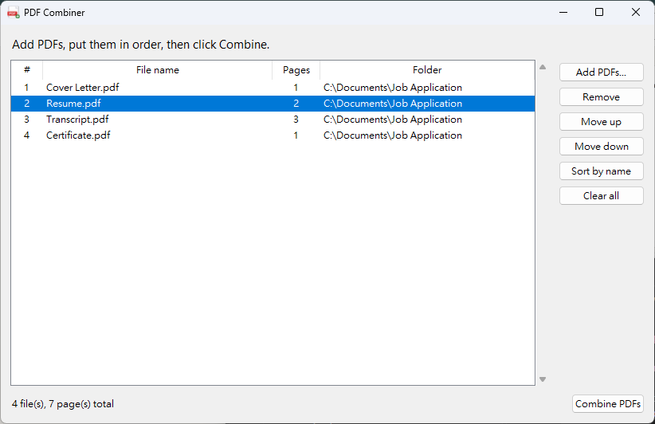

# PDF Combiner

A simple desktop app for combining any number of PDF files into one, in the order you choose.



## Features

- Add as many PDFs as you like, from any folders
- Reorder files with Move up / Move down, or sort them by name
- See the page count of each file and the total
- Damaged or unreadable files are skipped with a clear message
- Your original files are never changed

## Quick start

Requires Python 3.9+.

**Windows:** double-click `Run PDF Combiner.bat`.

**Any system:**

```
pip install -r requirements.txt
python app.py
```

For step-by-step instructions and troubleshooting, see the **[User Manual](MANUAL.md)**.

## Project files

| File | Purpose |
|---|---|
| `app.py` | The window and buttons (Tkinter) |
| `merger.py` | The code that combines the PDFs (pypdf) |
| `requirements.txt` | The library the app needs |
| `Run PDF Combiner.bat` | Windows launcher |
| `icon.ico`, `icon.png` | App logo |
| `MANUAL.md` | User manual |
